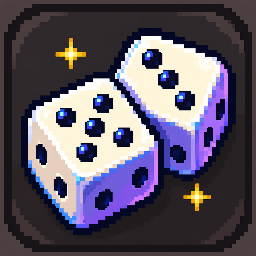

<p align="center">
  
</p>

<h1 align="center">WODE</h1>
<p align="center"><strong>Tokens are expensive. Feeling lucky? 🎲</strong></p>
<p align="center">A local AI coding agent with a twist: play games to win back the credits spent on your tasks.</p>

WODE is a Windows desktop fork of **[Cline](https://github.com/cline/cline)**. It builds on Cline’s coding agent, model integrations, tools, approvals, terminal, and workspaces, with a redesigned interface and a local credit system.

> **Just for memes. 🎲** The game odds, multipliers, and payouts aren't properly set up or balanced yet. This is an experimental project built for fun.

**Credits have no cash value and cannot be redeemed. Games change your local credit balance; your model provider’s actual API charges stay unchanged.**

## What’s inside

- **A coding agent that already works:** Cline’s existing agent and tools, with support for its model providers and your own API keys.
- **A quieter desktop interface:** warm dark surfaces, readable chat typography, and selectable gambling-themed pixel art app icons.
- **Opt-in games:** click the tokens beside a completed response to open Gamba. Games open on demand by default.
- **Auto Gamba:** an optional setting plays random games for each new completed response until its token cost is free or reaches a chosen percentage reduction, with a live mini player and stop controls.
- **A credit wallet:** 10,000 starting credits, a visible credit balance and token counter.
- **Usage and history:** actual tokens, adjusted costs, per-response game history, and JSON export.
- **Win/loss feedback:** green `+tokens` and red `−tokens` fade beside the token counter as games settle.
- **Local storage:** balances and game outcomes persist on your device. No WODE hosted backend is required; inference uses your configured model provider.

## Credits

**1 credit = 1,000 tokens.** The starting 10,000 credits represent 10 million tokens.

A completed response deducts its reported input + output tokens from the wallet. Cached input is already included in input usage. For example, a 23,536-token response costs **23.536 credits**.

Playing a game changes that response’s adjusted cost, and the wallet refunds or deducts the difference. If you stake a response costing 10 credits in Blackjack:

| Result | New response cost | Wallet adjustment |
| --- | --- | --- |
| Win | 0 credits | Refund 10 credits |
| Tie | 10 credits | No change |
| Lose | 20 credits | Deduct another 10 credits |

You can play again using the response’s latest adjusted cost. Results compound, and each game stays in that response’s history. Once a response is free, there is no remaining cost to stake.

The sidebar shows your credit balance and its token equivalent. Existing saved responses count toward spending. A negative balance is shown explicitly and does not block actual API usage.

Games display and stake **tokens**, including Roulette chips and game history. Credits are the wallet’s conversion: every 1,000 tokens spent or refunded equals 1 credit.

Credits have **no cash value**. Dollar estimates are displayed separately and depend on the model provider’s pricing.

## Auto Gamba

Enable **Settings → General → Auto Gamba** to automatically play on new completed responses. Choose **All or nothing** to play until free, or **Percent wins** and enter a 1–100% token reduction. For example, 25% stops a 10,000-token response at 7,500 tokens or below. The target is based on original token usage; games may overshoot it. The value saves when you leave the box or press Enter. Each run keeps the goal saved when that response completed, so changed goals apply to new responses. It starts disabled and does not process older history when enabled. Each active response plays independently at the same time, with a compact player floating over the chat near its token badge. Players reposition to avoid each other and share a scrollable floating stack when space is limited. They hide when you leave Chat or open Usage while runs continue in the background. Expand History to see recent results. Each new round uses that response’s updated token stake; costs can increase before a free result.

Use **Cancel** on a player to stop only that response, or disable Auto Gamba in Settings to stop all queued runs. An unfinished Blackjack hand or Mines board can be continued manually. Progress and pending requests persist locally, so an enabled run can resume after a backend restart without replaying a move. Games do not affect actual API billing.

## Games

All displayed multipliers apply directly to the staked cost: **0× is free, 0.5× halves the cost, and 2× doubles it.**

| Game | How it works |
| --- | --- |
| **Blackjack** | Hit or stand. Any win makes the stake free; a loss costs 2×; a tie stays at 1×. Dealer stands on all 17s. |
| **Dice** | Choose a target and roll over or under. The win chance determines the winning cost multiplier; a miss costs 2×. |
| **Plinko** | Choose risk and rows. The outermost slots are free; costs rise toward the center. |
| **Mines** | Start at 2× and reveal safe gems to reduce the multiplier. Cash out before hitting a mine. |
| **Roulette** | Stack token chips across numbers and outside bets. Winning red/black bets refund the full amount placed; losing bets add that amount. Unplaced tokens stay unchanged. |
| **Slots** | Drag the lever down and release. Three Jackpot icons make the stake free, other triples cost 0.25×, pairs cost 0.5×, and no match costs 2×. |

Rules, calculations, and slot probabilities are available through the **ⓘ** button in each game. Saved historical outcomes retain their original results.

## Run from source

Requirements:

- **Bun 1.4.2+** and **Node.js 22+**. Use Bun for dependencies and scripts.
- A supported model provider API key or supported provider login.
- For the native Windows app: Rust stable with the MSVC toolchain, Visual Studio C++ Build Tools with the Windows SDK, and WebView2 Runtime.

```powershell
# The WODE implementation currently lives on this branch.
git clone --branch wode https://github.com/aimlloser/rollcode.git wode
cd wode

bun install
bun run build:sdk

# Native Windows desktop app
bun run wode:desktop
```

For development without the native shell:

```powershell
bun run wode
```

Open `http://localhost:3125`. The local backend runs on `127.0.0.1:3126`. Optional upstream cloud and account features still use their respective services; they are not required for local use with your own API key.

SDK dependencies resolve through compiled files. Rebuild with `bun run build:sdk` after changing SDK source. Restart the backend after backend changes.

## Build a Windows installer

```powershell
bun run wode:build
```

The packaging script copies installers into `apps/examples/desktop-app/dist/desktop/`. Packaged users do not need Bun or Node.js installed.

For additional development notes and accounting details, see [WODE.md](WODE.md). WODE is currently a development MVP.

## Persistence

New installations store the credit ledger at `%USERPROFILE%\.wode\ledger.sqlite`. Existing installations reuse `%USERPROFILE%\.rollcode\ledger.sqlite` when no WODE ledger exists, preserving balances and history. `WODE_LEDGER_PATH` overrides the location; the previous environment variable remains supported. Model credentials, chats, and provider settings use Cline’s existing local storage.

Game logic is modular under [`sidecar/wode`](apps/examples/desktop-app/sidecar/wode). The backend uses cryptographically secure randomness. SQLite transactions save game state, outcomes, and request receipts together, so retrying an action does not draw again or charge twice.

The wallet derives spending from saved response costs rather than replaying debit events. Keep the database and its WAL/SHM files together when backing up a running app, or quit before copying it.

## Built on Cline

WODE is **forked from [cline/cline](https://github.com/cline/cline)**, including the [desktop implementation](https://github.com/cline/cline/tree/main/apps/examples/desktop-app). The underlying coding agent is reused rather than rebuilt.

The upstream **[Apache License 2.0](LICENSE)**, copyright notices, and **[NOTICE](NOTICE)** are retained. WODE is an independent modification and is not endorsed by Cline. Bundled fonts retain their respective license notices.

Game interfaces use original code and artwork inspired by casino games. WODE is not affiliated with Stake and does not include Stake branding or assets.
